# Deploying PhilGEPS on AWS and learning CI/CD

## Current status

The foundation is deployed in account `223662763464`, region `ap-southeast-2`,
for [rgaidjr/code-test](https://github.com/rgaidjr/code-test). GitHub staging and
production environments are configured; production requires review by `rgaidjr`.
Application deployment and cloud smoke testing are being verified through CI.
Docker is not installed on this computer, so container execution runs on the
GitHub Linux runner.

The defaults use the configured region, `ap-southeast-2`, and project name `philgeps`.
Change them before bootstrapping if you prefer another region/name. This setup
uses GitHub Actions, AWS CloudFormation, and Lambda containers to keep idle
infrastructure small. It does not require Kubernetes, a load balancer, a NAT
gateway, or an always-running server.

## What runs where

```mermaid
flowchart LR
    PR[Pull request] --> CI[Lint, tests, IaC validation, dependency audit]
    CI --> CT[Build and test a fixture container]
    MAIN[Merge to main] --> CI
    CT --> DATA[Fetch locked S3 dataset version]
    DATA --> BUILD[Build real image and smoke-test]
    BUILD --> ECR[Private ECR registry and vulnerability scan]
    ECR --> STAGE[Staging Lambda candidate]
    STAGE --> CHECK[Signed HTTP smoke tests]
    CHECK --> LIVE[Staging live alias]
    LIVE --> APPROVE[Manual production promotion and environment approval]
    APPROVE --> PROD[Same image digest in production]
```



| Component | Responsibility | What you learn |
| --- | --- | --- |
| GitHub | Source, pull requests, environments, workflows | Review and release controls |
| OIDC + IAM | Short-lived deploy credentials, separate staging/production identities | Authentication and scoped permissions |
| CloudFormation | Reproducible infrastructure | Infrastructure as code and resource lifecycle |
| S3 | Private, versioned CSV snapshots | Data versioning independent of Git |
| ECR | Private images with immutable tags and scanning | Container artifacts and software supply chain |
| Lambda + Function URLs | HTTPS API, authenticated with AWS IAM | Serverless execution, versions, aliases |
| Secrets Manager | OpenAI credentials, separate per environment | Runtime secrets outside code and CI |
| CloudWatch | Structured request logs and alarms | Observability and troubleshooting |

`api.py` adds `GET /health`, `GET /dataset`, `POST /query`, and
`POST /investigate`. It uses the same dataset functions and agent loop as the
CLIs. The existing MCP server remains a local stdio interface; this first AWS
release exposes the equivalent operations as HTTP endpoints, not a remote MCP
endpoint. No website or public anonymous API is created.

## 1. Verify your AWS identity

The working profile is `agent-toolkit`, which uses an AWS login session. The
installed AWS CLI 2.15 does not support that credential provider; the project
Python SDK works after installing its `botocore[crt]` extra. Use the SDK-based
bootstrap command below, or update the AWS CLI through AWS's installation guide
before using CLI commands with this profile. Do not replace the working profile
with long-lived keys to work around an outdated CLI.

Use IAM Identity Center / an AWS CLI SSO profile when your organization uses SSO. Do not put AWS
access keys in this repository, `.env`, or GitHub secrets. Sign in in your own
terminal and check the account before creating resources:

```powershell
aws configure sso --profile learning
aws sso login --profile learning
$env:AWS_PROFILE = "learning"
aws sts get-caller-identity
```

These SSO commands require your organization's SSO configuration. If your account
uses another sign-in method, configure that AWS profile instead. A root account
access key should not be used. The profile used for initial bootstrap needs
permission to create IAM roles, an OIDC provider, S3, ECR, Secrets Manager, and
CloudFormation stacks. CI subsequently uses the narrower generated roles.

## 2. Create/select the GitHub repository

Supply the intended `OWNER/REPOSITORY` before bootstrapping. The OIDC trust is
restricted to that repository's `staging` or `production` environment.

The CSV is 125 MB and exceeds GitHub's normal single-file Git limit. It is now
ignored by Git. Keep `.env`, `.venv`, `.cache`, `.build`, and deployment output
files out of source control. Commit code, tests, lockfiles, infrastructure, the
dataset manifest, and workflows.

The selected repository is `rgaidjr/code-test`, and the local Git remote points
to it. The initial code push starts the deployment workflow.

## 3. Bootstrap the foundation once

Review `infra/foundation.yaml`. This creates persistent shared resources and two
separate deploy/runtime identities. It does not deploy the application.

Set your selected values in PowerShell:

```powershell
$project = "philgeps"
$region = "ap-southeast-2"
$repository = "rgaidjr/code-test"
```

If your AWS account already has a GitHub OIDC provider, reuse it. Check:

```powershell
aws iam list-open-id-connect-providers
```

For an existing provider, inspect it with `aws iam get-open-id-connect-provider`
and set `$providerArn` to the provider for
`https://token.actions.githubusercontent.com`. If none exists, use an empty string:

```powershell
$providerArn = ""
aws cloudformation deploy --region $region --stack-name "$project-foundation" --template-file infra/foundation.yaml --capabilities CAPABILITY_IAM --parameter-overrides "ProjectName=$project" "GitHubRepository=$repository" "ExistingOidcProviderArn=$providerArn"
aws cloudformation describe-stacks --region $region --stack-name "$project-foundation" --query "Stacks[0].Outputs" --output table
```

Review the account shown in step 1 before executing. OIDC providers are
account-wide; attempting to create a duplicate provider will fail. The initial
bootstrap is an administrator operation, not a responsibility of the CI role.

For the existing login-session profile, the SDK-based equivalent is:

```powershell
.\.venv\Scripts\python.exe -m scripts.bootstrap --profile agent-toolkit --repository rgaidjr/code-test --region ap-southeast-2 --execute
```

Without `--execute`, it creates and validates a change set without provisioning
its resources. The foundation has already been created; do not repeat bootstrap
unless you intend to update it. No durable CloudTrail trail was configured in
the account during setup. Account management-event history is available, but
long-term audit retention has not been enabled by this project.

## 4. Upload and lock the dataset

Use the `DatasetBucket` stack output:

```powershell
.\.venv\Scripts\python.exe -m scripts.dataset upload --bucket YOUR-DATASET-BUCKET --region $region
```

This uploads the CSV with a SHA-256 checksum and records its bucket, object key,
S3 version ID, byte size, row count, encoding, and checksum in `dataset.lock.json`.
The current manifest already contains the local checksum, but its bucket and
version ID are intentionally unset until upload succeeds.

Commit the completed manifest. Every release downloads that exact object version,
checks its bytes, and embeds it into the image. Replacing an S3 object without
changing the manifest does not change a release's data. Local CSV changes require
another upload and a reviewed manifest change.

## 5. Configure GitHub environments and branch rules

Create GitHub environments named exactly `staging` and `production`.

- Restrict both to the `main` deployment branch.
- Add a required reviewer for production when your GitHub plan/repository
  visibility supports it. If self-review must be possible for solo learning,
  configure that deliberately. These rules require GitHub settings; declaring
  `environment: production` in YAML alone does not create an approval gate.
- Protect `main`: require pull requests and the CI checks; block force pushes.
- Keep default workflow token permissions read-only.

Set repository **variables**, not secrets:

| Variable | Value |
| --- | --- |
| `AWS_REGION` | Selected AWS region |
| `PROJECT_NAME` | `philgeps`, or your selected name |
| `ECR_REPOSITORY_URI` | Foundation `RepositoryUri` output |
| `DEPLOY_ENABLED` | `true` once the approved dataset snapshot is uploaded; leave unset to pause staging deployments |

Set these **environment variables** separately in each GitHub environment:

| Variable | Staging output | Production output |
| --- | --- | --- |
| `AWS_ROLE_ARN` | `StagingDeployRoleArn` | `ProductionDeployRoleArn` |
| `EXECUTION_ROLE_ARN` | `StagingExecutionRoleArn` | `ProductionExecutionRoleArn` |
| `OPENAI_SECRET_ARN` | `StagingSecretArn` | `ProductionSecretArn` |

No long-lived AWS credentials or OpenAI keys are stored in GitHub. The staging
role can read the versioned dataset and push images. The production role promotes
images but cannot push them or read the OpenAI secret value. Both roles are
restricted to the selected environment's Lambda and CloudFormation stack.

## 6. Configure the OpenAI secret when ready

The foundation creates empty model-key fields, so SQL and dataset endpoints can
be deployed without paying for model calls. `/investigate` returns 503 until a
key is configured. Your earlier API diagnostic returned
`credit_balance_exhausted`; API credits are still required for model calls.

To copy your locally configured key to the **explicitly selected** secret:

```powershell
.\.venv\Scripts\python.exe -m scripts.set_secret --secret-arn YOUR-STAGING-SECRET-ARN --region $region
```

Repeat for production only when you want it enabled there. This reads `.env` or
the local environment and sends the value directly through the AWS SDK without
printing it or putting it in shell arguments. Runtime roles read only their own
secret. Values are cached per warm process; key rotation requires recycling the
old execution environments or deploying a new version/configuration.

## 7. Understand the pipeline

**Pull request:** `.github/workflows/ci.yml` installs hash-locked dependencies,
runs Ruff, tests, CloudFormation validation, lockfile checks, and a dependency
vulnerability audit. It builds and tests an image with a one-record fixture.
This job has no AWS credentials and never reads your real dataset or API key.

**Merge to main:** `.github/workflows/deploy.yml` first runs those same checks,
then assumes the staging IAM role via OIDC. It downloads the pinned dataset,
builds one real image, tests it with Lambda's local emulator, pushes it to ECR,
and blocks the release if the image scan reports HIGH or CRITICAL findings.
An incomplete/failed scan also blocks deployment; it is not silently skipped.

The release script updates a CloudFormation stack containing the function,
14-day log group, and alarms. This changes `$LATEST`, which receives no live
traffic. It then publishes a numbered immutable Lambda version and updates a
`candidate` alias. A candidate Function URL uses `AWS_IAM` authentication.

Smoke tests verify that anonymous requests are rejected, the code/dataset identity
matches, and a signed SQL query returns the expected dataset count. Only then
does the script move the `live` alias. A failed post-promotion smoke test restores
the previous live version. If the first release fails, its broken live URL is
removed. The candidate is retained for diagnosis.

**Production:** run **Build, stage, and promote** manually on `main`, with
`promote_production` enabled. After staging passes and any configured environment
approval is satisfied, production receives the exact same ECR digest. It is not
rebuilt. Normal merges deploy only to staging.

The pipeline owns aliases/Function URLs through `scripts/release.py`;
CloudFormation owns function configuration, logs, and alarms. This separation is
intentional: updating infrastructure or `$LATEST` cannot accidentally direct
live traffic to untested code. Release summaries record the image URI, revision,
version, previous version, dataset checksum, and URL.

Dependencies and base images are pinned. Dependabot opens update PRs. Python
updates must regenerate both lockfiles before CI passes:

```powershell
.\.venv\Scripts\uv.exe pip compile --universal --generate-hashes --python-version 3.12 requirements.txt --output-file requirements.lock
.\.venv\Scripts\uv.exe pip compile --universal --generate-hashes --python-version 3.12 requirements-dev.txt --output-file requirements-dev.lock
```

## 8. Call the deployed API

Function URLs are HTTPS but require AWS IAM signing. Opening one anonymously in
a browser should return 403. A token from `.env` is not cloud authentication.
Use a signed client with an AWS identity allowed both `lambda:InvokeFunctionUrl`
and `lambda:InvokeFunction` on the function/alias:

```powershell
.\.venv\Scripts\python.exe -m scripts.cloud_client YOUR-FUNCTION-URL health --region $region
.\.venv\Scripts\python.exe -m scripts.cloud_client YOUR-FUNCTION-URL query --region $region --sql "SELECT region, COUNT(*) AS notices FROM notices GROUP BY region ORDER BY notices DESC LIMIT 5"
.\.venv\Scripts\python.exe -m scripts.cloud_client YOUR-FUNCTION-URL investigate --region $region --question "Which regions have the largest approved budgets?"
```

The deployment roles have invoke permissions. A separate human/operator role
needs the same two actions for the selected function/aliases; an IAM policy is
still needed even when the URL is known. There is no public Function URL policy.

Cold environments must create the local SQLite index in `/tmp`. This can add
noticeable initial latency. Warm invocations reuse the index. Each environment
has a 1 GiB scratch area, 2 GiB memory, and a 180-second function timeout. Model
investigations have their own 120-second budget and at most eight tool calls.

## 9. Observe and roll back

Look at `/aws/lambda/philgeps-staging` or the corresponding production log group.
Request logs contain a request ID, path, status, service name, and duration. They
omit headers, prompts, SQL, model responses, and secret values.

CloudWatch alarms cover Lambda runtime errors, throttles, and handled HTTP 5xx
responses. Alarms have no notification destination until you configure one.
They are observability signals, not an automatic ongoing rollback system.
Automatic rollback here applies to deployment smoke-test failures.

Use the **Roll back a release** workflow with the environment and a previous
numeric Lambda version from the release summary. It validates that version as a
candidate before moving `live`. The CLI equivalent is:

```powershell
.\.venv\Scripts\python.exe -m scripts.release rollback --function philgeps-staging --version 1 --region $region
```

ECR retains tagged images so an older live/rollback version does not lose its
image. Only untagged images expire automatically. Retire old versions and images
together, after confirming they are not used by either environment or a rollback
you need. No automatic destructive artifact cleanup runs in this project.

## 10. Cost controls and teardown

AWS charges can include Lambda execution, ECR storage/scanning, Secrets Manager,
S3 versions, CloudWatch logs/metrics/alarms, and data transfer. OpenAI charges are
separate. No fixed monthly cost ceiling is guaranteed by this setup. Keeping the
endpoint IAM-only prevents anonymous public callers from consuming model credits.

Create an optional budget alert after choosing an email and amount:

```powershell
aws cloudformation deploy --region $region --stack-name "$project-budget" --template-file infra/budget.yaml --parameter-overrides "ProjectName=$project" "Email=YOUR-EMAIL" "MonthlyUsd=20"
```

This budget monitors the whole account, not just this application. **Budget
alerts do not stop spending.** Check Billing/Cost Explorer after the first deploy.
The stack does not reserve Lambda concurrency automatically because low-quota
new AWS accounts may not support a reservation; configure a suitable cap after
checking your account's concurrency quota if you enable frequent model calls.

For teardown, first stop scheduled/workflow deployments. Review deletion of the
staging/production CloudFormation stacks and the pipeline-managed aliases/URLs
(deleting the function removes those). The foundation **retains** its S3 bucket,
ECR repository, and secrets to avoid deleting data and rollback artifacts by
accident. Removing the foundation does not remove those retained resources or
their storage charges. Delete them separately only after deciding the data and
images are no longer needed. Also remove the budget stack when appropriate.

## Local development and verification

```powershell
.\.venv\Scripts\python.exe -m pip install --require-hashes -r requirements-dev.lock
$env:SERVICE_API_TOKEN = .\.venv\Scripts\python.exe -c "import secrets; print(secrets.token_urlsafe(32))"
$env:AUTH_MODE = "bearer"
.\.venv\Scripts\python.exe -m uvicorn api:app --host 127.0.0.1 --port 8000
```

Use `Authorization: Bearer <SERVICE_API_TOKEN>` for `/dataset`, `/query`,
`/investigate`, and `/docs`. For local HTTP model calls, set `OPENAI_API_KEY` in
the process environment (or call the existing CLI that loads `.env`). The cloud
service gets its key from Secrets Manager.

With Docker installed, prepare the local real CSV before building:

```powershell
.\.venv\Scripts\python.exe -m scripts.dataset local
docker build --platform linux/amd64 -t philgeps-local .
docker run --rm -p 9000:8080 philgeps-local
```

In another terminal, run `python -m scripts.container_smoke --records 196202`.
The emulator accepts synthetic IAM event payloads for local testing; it is not
a production authentication boundary. Bind its port only to localhost when
working on an untrusted network.

Current evidence: 49 tests passed and two live-model checks skipped; Ruff and
all CloudFormation templates passed; the locked runtime dependency audit found
no known vulnerabilities. GitHub Actions syntax and expressions also passed
actionlint validation. The AWS execution policy, real container build, image
scan, GitHub workflows, deployed endpoint, and cloud smoke tests remain unrun.

## Suggested learning exercises

1. Deliberately break a test in a branch and watch CI block it.
2. Fix the test, merge a small `/health` change, and watch staging deploy.
3. Compare Git SHA, ECR digest, Lambda version, and `live` alias. Each identifies
   a different layer of a release.
4. Request production promotion and inspect the approval boundary.
5. Roll back to the previous version and verify `/health` changes immediately.
6. Upload a changed dataset and review the manifest diff before releasing it.
7. Find one request by its ID in CloudWatch and inspect the HTTP-error alarm.

References: [GitHub OIDC with AWS](https://docs.github.com/en/actions/how-tos/secure-your-work/security-harden-deployments/oidc-in-aws),
[Lambda container images](https://docs.aws.amazon.com/lambda/latest/dg/images-create.html),
[Function URL authentication](https://docs.aws.amazon.com/lambda/latest/dg/urls-auth.html),
[Lambda aliases](https://docs.aws.amazon.com/lambda/latest/dg/configuration-aliases.html).
